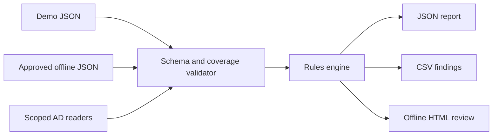

# Architecture: read-only review pipeline

## Boundaries and failure handling

- `Invoke-ServiceAccountHygieneAudit.ps1` handles CLI parameters, input loading, and output path selection. It does not mutate AD objects.
- `src/ServiceAccountHygiene.psm1` contains three exported functions: `Invoke-ServiceAccountHygieneAnalysis`, `Export-ServiceAccountHygieneReport`, and `Get-AdServiceAccountHygieneSnapshot`.
- Offline mode has no dependency on the AD module; no network access required.
- Live collector uses Windows `ActiveDirectory` module and only read cmdlets. It requires **two explicit search bases**. Errors reading account search bases abort; privileged group errors mark membership as `Partial`.
- The rule engine requires a nonempty `accounts` array and valid schema/UTC timestamps, rejects string booleans, and de-duplicates by SID.
- Unknown booleans or missing `passwordLastSetUtc` (for enabled legacy accounts) are reported as missing evidence, never silently treated as `false`.
- The module returns findings as objects; output adapters export JSON, spreadsheet-safe CSV, and an offline HTML table with encoded cell values.
- Output names include UTC timestamp and a random suffix, avoiding accidental overwrites.

## Coverage semantics

`collection.accountsStatus` and `collection.privilegedMembershipStatus` are independently one of `Complete`, `Partial`, or `NotCollected`. These statuses describe completion **only of the declared search scopes**, not an entire enterprise inventory. An incomplete status makes the assessment `Incomplete evidence - review required`.

A successful empty configured group list is not `Complete`: privilege is `NotCollected` and generates `SA-E02`. Positive memberships already observed may still generate findings even when other group queries failed.

## Roadmap after MVP

- Signed snapshot/evidence manifest and retention-safe export.
- Optional CMDB/service ownership import with per-field provenance.
- Dedicated gMSA host/retrieval-principal posture checks with documented AD permissions and valid baselines.
- Incremental comparisons and approved, reviewed suppressions with expiration dates.
- Pipeline invocation in controlled Windows job runners and secured report destinations.
